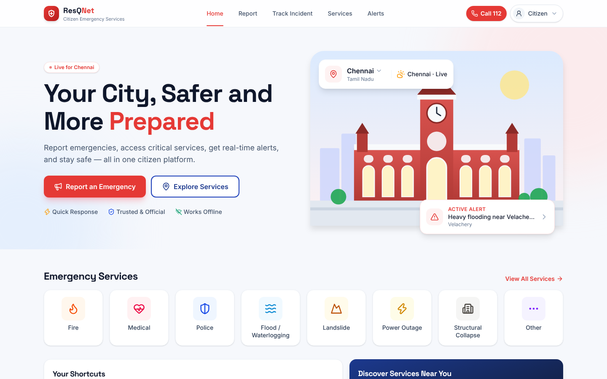
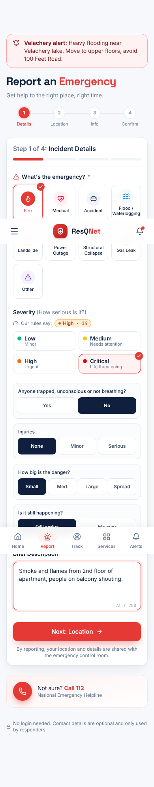
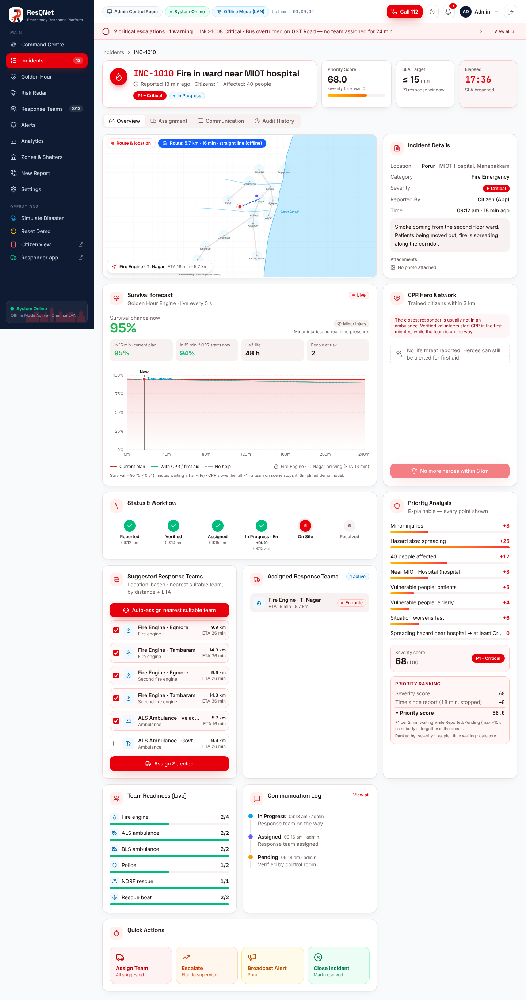
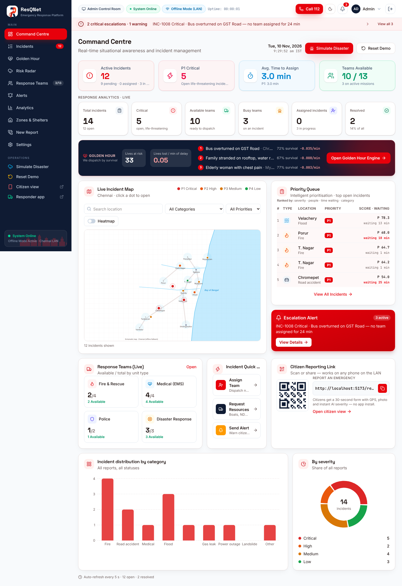
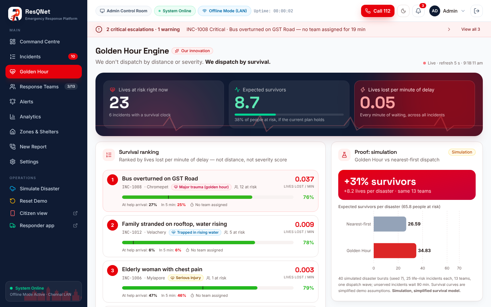
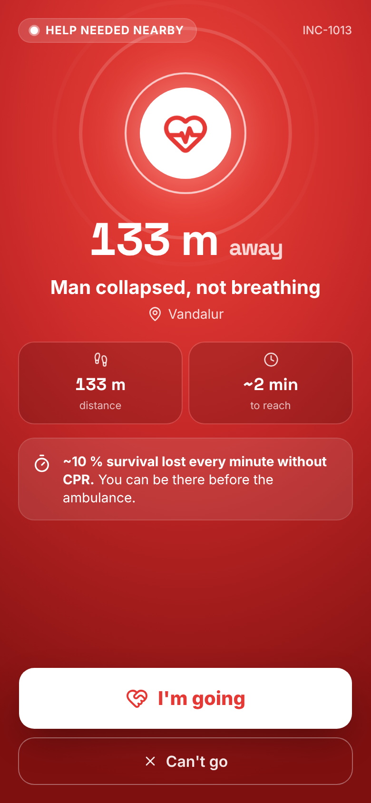
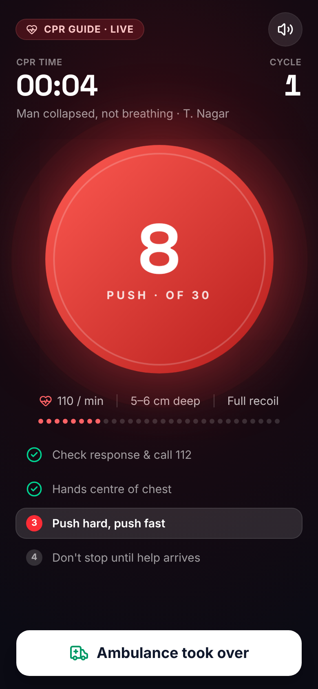
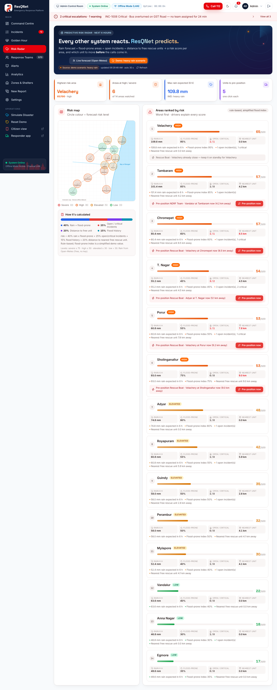
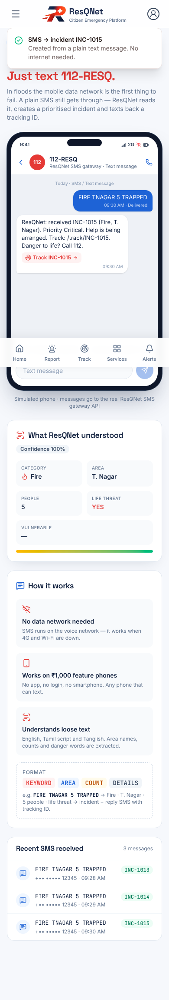
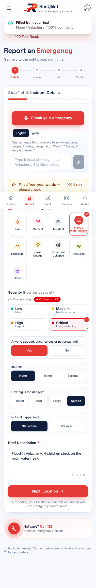

# 🚨 ResQNet

> **Explainable, Survival-Aware Emergency Response & Disaster Management Platform — from report to rescue, even when networks fail.**


**Team Ctrl.Alt.Elite** (Umer Basith, Muizzur Rahman) · Code Clash 2026 · Crescent Institute, Chennai

> *ResQNet ranks every emergency with explainable rules and sends the **right** team (not just the nearest). It keeps working when networks fail. Its innovations dispatch by **survival**, turn trained citizens into first responders, accept reports by **SMS** and **voice in Tamil**, and **predict** where help will be needed before people call.*



---

## 📑 Contents
1. [Problem Statement](#-problem-statement)
2. [Features](#-features)
3. [Round 1 — every required feature and where it is](#-round-1--emergency-incident-reporting--monitoring)
4. [Round 2 — every required feature and where it is](#-round-2--intelligent-coordination)
5. [Innovations — what makes ResQNet different](#-innovations--what-makes-resqnet-different)
6. [Tech Stack](#️-tech-stack)
7. [Project Structure](#-project-structure)
8. [Installation & Setup](#️-installation--setup)
9. [How It Works](#-how-it-works)
10. [API Reference](#-api-reference)
11. [Scalability](#-scalability)
12. [Feasibility](#-feasibility)
13. [Novelty & Comparative Analysis](#-novelty--comparative-analysis)
14. [Feature Depth & Edge-Case Engineering](#-feature-depth--edge-case-engineering)
15. [Testing & Quality](#-testing--quality)
16. [Honest Limits & What's Next](#️-honest-limits--whats-next)
17. [Ethical Use & Operational Disclaimer](#️-ethical-use--operational-disclaimer)
18. [Author & Team](#-author--team)

---

## 📌 Problem Statement

During road accidents, fires, floods and building collapses, a city's emergency response depends on getting the **right help to the right place fast**. Chennai's 2015 and 2023 floods showed how this breaks down. Control rooms and reporting tools suffer from five problems:

1. **Reports arrive from everywhere, unranked.** Calls, messages and app reports land in a first-come-first-served list. A fallen tree and a family trapped on a rooftop look the same until a person reads both, and during a disaster nobody has time to.
2. **Severity is a guess, not a rule.** When priority is decided by gut feeling, it can't be explained, audited or checked by judges, supervisors or courts.
3. **"Nearest team" is often the wrong team.** A fire engine 2 km away is useless for a rooftop flood rescue that needs a boat. Distance alone ignores skills, equipment and *how fast each victim's chance of survival is falling*.
4. **Networks and people fail first.** Mobile data drops in floods. Many citizens use feature phones, panic, or can't type in English. A smartphone-only, English-only form leaves the most vulnerable people out.
5. **Systems react, they don't anticipate.** Teams are dispatched only after calls arrive, even when heavy rain over flood-prone areas makes the next hotspots predictable.

**ResQNet** solves this with a role-based web platform for **citizens**, the **control room** and **field responders**:
- an explainable rules engine that scores and ranks every incident, with its reasons
- skill- and distance-aware dispatch with route visualisation and lifecycle tracking
- five innovations: a **Golden Hour** survival-based dispatch engine, a **CPR Hero Network** of nearby trained citizens, a **Predictive Risk Radar**, an **SMS fallback**, and **Speak to Report** in Tamil and English

---

## 🚀 Features

| Feature | Subsystem | Engineering Mechanism & Algorithms | Output Artifact | Status |
|---|---|---|---|---|
| **Citizen Emergency Reporting** | Report flow (`ReportFlow.tsx`) | 4-step mobile flow with picture tiles; auto-title; validation; live GPS / map tap / area list; anonymous switch; photo compressed on the phone | Validated incident stored in Supabase with a tracking ID | **Working** |
| **Explainable Severity Engine** | Rules engine (`severity.py`) | Weighted score (Life 35 + Hazard 25 + Exposure 20 + Vulnerable 10 + Time 6) + safety override rules R1–R9 | Low / Medium / High / Critical + score 0–100 + list of reasons | **Working** |
| **Intelligent Prioritisation** | Ranking (`main.py` `with_priority`) | Severity score + time-since-report bonus (+1 per 2 min unassigned, max +10); sort by level → priority score | Ranked incident queue with "waiting N min" | **Working** |
| **Skill-Aware Nearest-Team Dispatch** | Dispatch (`dispatch.py`) | Required "slots" per category (boat, NDRF, ALS…); Haversine distance; ETA = 2 min + distance ÷ speed; top 3 per slot; auto-assign | Suggested / assigned teams with km + ETA | **Working** |
| **Assignment & Lifecycle Tracking** | Responder portal (`Responder.tsx`) | Reported → Pending → Assigned → In Progress → Resolved; accept / reject with reason / en route / on scene / completed with note | Timeline + audit; team busy/available updates | **Working** |
| **Route & Location Visualisation** | Maps (`IncidentMap.tsx`, `useRoutes.ts`) | MapLibre GL + CARTO Voyager / OpenFreeMap tiles; OSRM road routing; straight-line and SVG offline fallbacks | Map with incidents, teams and team→incident route lines | **Working** |
| **Team Management** | Teams (`Teams.tsx`, `TeamDetail.tsx`) | Create / edit / delete; availability; station coordinates; crew; performance | Team roster + detail dashboards | **Working** |
| **Analytics Dashboard** | Analytics (`Analytics.tsx`, `/api/analytics`) | Totals, critical, available/busy teams, assigned, resolved, by category/area/hour, time-to-assign, utilisation | Live KPI tiles + charts | **Working** |
| **Golden Hour Engine** ⭐ | Survival model (`golden.py`) | Exponential survival decay per condition; greedy max-expected-lives team assignment; seeded simulation | Lives at risk, lives lost/min, plan, +31 % simulated survivors | **Working (simulation-backed)** |
| **CPR Hero Network** ⭐ | Heroes (`heroes.py`, `HeroLive.tsx`) | Live opt-in citizens with a 15 s heartbeat; nearest-3 alert with widening radius; CPR metronome guide | Popup alerts on citizen phones; survival curve bends up | **Working** |
| **Predictive Risk Radar** ⭐ | Risk (`risk.py`) | Open-Meteo 6 h rain × flood-prone index + incident pressure + coverage gap | Area risk 0–100 + "pre-position" recommendations | **Working** |
| **SMS Fallback** ⭐ | NLP (`nlp.py`, `/api/sms`) | Keyword parser for English / Tamil script / Tanglish | Incident + reply SMS with tracking ID | **Working (gateway simulated)** |
| **Speak to Report** ⭐ | Speech (`speech.ts`, `/api/parse`) | Browser speech recognition (en-IN / ta-IN) → parser → form auto-fill | Pre-filled report with confidence | **Working (needs Chrome + mic)** |
| **Disaster Zones, Shelters & Alerts** | Zones / Alerts pages | Zone status, shelter occupancy, area-targeted public alerts | Citizen alert banners, shelter capacity bars | **Working** |

---

## ✅ Round 1 — Emergency Incident Reporting & Monitoring

| # | Required by the brief | What we built | Where |
|---|---|---|---|
| 1 | **Reporting form**: title, description, category, location, people affected, optional contact | 4-step mobile flow (Details → Location → Info → Confirm). Title is auto-suggested ("Fire at T. Nagar") and editable; description is validated (10+ characters); location comes from **live GPS**, a map tap or an area list; people affected and injured use +/− steppers; contact is optional with a **"Report anonymously"** switch; optional photo evidence (compressed on the phone) | `frontend/src/sections/ReportFlow.tsx`, `POST /api/incidents` |
| 2 | **Categories**: Fire, Road Accident, Medical, Flood, Building Collapse, Other | All 6, plus **Landslide, Power outage / Electrical, Gas leak** (9 picture tiles, no reading needed) | `IncidentUI.tsx` `CATEGORY_META`, `schemas.py` `Category` |
| 3 | **Severity** Low / Medium / High / Critical by a logical mechanism | Deterministic **rules engine**: score = Life threat (35) + Hazard (25) + Exposure (20) + Vulnerable people (10) + Time-critical (6), plus **safety override rules** R1–R9 (e.g. *trapped / not breathing → always Critical*, *5+ injured → Critical*, *active fire or gas → at least High*). **Every point is shown as a reason** ("Unconscious / trapped +35 (R1)"). Live preview while typing | `backend/app/severity.py`, `POST /api/severity/preview` |
| 4 | **Dashboard**: total, critical, pending, resolved, by category | Command Centre tiles + incidents-by-category chart + severity donut + live map (critical incidents pulse) + escalation banner, refreshed every 5 s | `pages/Dashboard.tsx`, `GET /api/stats` |
| 5 | **Incident management**: view all, open details, update status, delete test / duplicate reports | Searchable, filterable ranked list; detail page with reasons, timeline and audit; status workflow with notes; **mark as duplicate** (the duplicate becomes a confirming witness and raises the main incident's score); **delete with confirmation** | `pages/Incidents.tsx`, `pages/IncidentDetail.tsx`, `PATCH /status`, `POST /duplicate`, `DELETE` |
| 6 | **UI/UX**: professional, responsive, critical highlighted | React + **Tailwind CSS**, tested at 390 px phone and 1440 px desktop with no sideways scrolling; critical incidents red and pulsing; colour is never the only signal (icon + label too); light and dark mode | whole `frontend/` |

**Statuses:** Reported → Pending → **Assigned** → In Progress → Resolved (every change is timestamped in the timeline).

 

---

## ✅ Round 2 — Intelligent Coordination

| # | Required by the brief | What we built | Where |
|---|---|---|---|
| 1 | **Intelligent prioritisation** by severity, people affected, **time since reporting**, category | `priority_score` = rules severity score (people, category, life threat, hazard, vulnerability) **+ waiting bonus** (+1 per 2 minutes without a team, up to +10). The queue ranks by severity level, then priority score. The incident page shows the breakdown | `main.py` `with_priority`, `GET /api/incidents` |
| 2 | **Team management**: name/ID, category, current location, availability, assigned incident | Create / edit / delete teams; availability dropdown (available, busy, offline); station and coordinates; assigned incident link; team detail page with crew, vehicles, equipment, performance and history | `pages/Teams.tsx`, `pages/TeamDetail.tsx`, `POST/PATCH/DELETE /api/teams` |
| 3 | **Location-based assignment**: nearest **available and suitable** team using coordinates and distance | Haversine distance + ETA (2 min to mobilise + distance ÷ speed). **Skill matching first** (boat for a flood, NDRF for a collapse, ALS for cardiac), then arrival time. Top 3 per need, **"Auto-assign nearest suitable team"** in one click, reject → next best suggested | `backend/app/dispatch.py`, `GET /suggest`, `POST /auto-assign` |
| 4 | **Assignment & tracking**: Assigned / In Progress / Resolved, team details, busy/available | Assigning sets the incident to **Assigned** and the team to **busy**. The responder app moves accepted → en route → on scene → completed (closing note required) and frees the team. Citizens follow the same progress on `/track/:id` | `pages/Responder.tsx`, `POST /api/assignments/{id}/…`, `pages/Track.tsx` |
| 5 | **Route & location visualisation** | MapLibre map (CARTO Voyager / OpenFreeMap tiles) with incidents, teams and a **road route line** (OSRM) between each assigned team and its incident, plus distance and time. A **straight-line fallback** and a built-in offline SVG Chennai map are used when there's no internet | `sections/IncidentMap.tsx`, `lib/useRoutes.ts`, `GET /api/route` |
| 6 | **Advanced analytics**: total, critical, available teams, busy teams, assigned, resolved, by category | Live tiles for all of these, plus reported-vs-resolved per hour, hotspots by area, average time to assign and resolve, team utilisation and a team performance table | `pages/Analytics.tsx`, `GET /api/stats`, `GET /api/analytics` |

Also included: escalation alarms (Critical with no team > 2 min, High > 5 min, team not accepting, resource shortage), public safety **alerts** pushed to the citizen pages, a **"Simulate disaster"** burst for live demos, disaster **zones & shelter** capacity management, and a field **responder portal** (accept/reject with reason, navigate, escalate, field updates, and sidebar pages for assignments, team status, alerts, reports, resources and settings).



---

## ⭐ Innovations — what makes ResQNet different

Most emergency apps stop at *report → dashboard → nearest team*. ResQNet adds five capabilities, each working end to end in this repo:

### 1. Golden Hour Engine — dispatch by **survival**, not by distance or severity
*Where:* `backend/app/golden.py`, `/admin/golden-hour`, survival chart on every incident.
- Each life-threatening incident gets a **survival profile**: survival = 95 % × 0.5^(minutes waiting ÷ half-life). The half-life depends on the condition (cardiac arrest ≈ 7 min, i.e. about 10 % per minute; trapped in fire 12; rising water 25; major trauma 60; under debris 10 h). CPR slows the fall (×3) and a team on scene stops it.
- Live **"lives at risk"** and **"lives lost per minute of delay"** counters; the queue can be ranked by lives lost per minute.
- **Dispatch plan:** when several emergencies compete for few teams, a greedy optimiser assigns teams to save the most expected lives, compared side by side with nearest-team-first. One click applies it.
- **Proof:** a seeded simulation (40 disaster bursts × 25 incidents, the same 13 teams) gives **≈ +31 % expected survivors (+8.2 lives per disaster)** versus nearest-first. *This is a simulation with simplified survival curves, labelled as such in the UI.*



### 2. CPR Hero Network — the closest responder is usually not in an ambulance
*Where:* `backend/app/heroes.py`, `/hero`, global popup in `sections/HeroLive.tsx`.
- Any citizen with the website open can opt in as a **CPR / first-aid trained hero**. Their phone checks in every 15 s with their location.
- A life-threat report **automatically alerts the 3 nearest heroes** (live users first). A **full-screen popup with sound and vibration** appears on whatever citizen page they have open.
- Hero flow: *I'm going → Navigate → Arrived → **CPR guide** (110 bpm metronome, 30:2 counter) → handed over to the ambulance*. When CPR starts, the incident's **survival curve visibly bends upward** for the control room.
- If nobody is within 3 km the search widens (up to 25 km); a decline alerts the next hero; the admin can send a specific hero by hand.

 

### 3. Predictive Risk Radar — every other system reacts, ResQNet predicts
*Where:* `backend/app/risk.py`, `/admin/risk`.
- Risk score per Chennai area for the **next 6 hours** = 40 % forecast rain (live Open-Meteo data, no API key) × how flood-prone the area is (simplified index from the 2015/2023 floods) + 25 % live incident pressure + 15 % flood history + 20 % distance to the nearest free rescue unit.
- Recommends **pre-positioning** a boat or NDRF team before calls arrive, in one click. A "heavy rain" scenario switch allows demos on dry days.



### 4. SMS fallback — works on a ₹1,000 feature phone with no data
*Where:* `backend/app/nlp.py`, `POST /api/sms`, `/sms` simulator.
- `FIRE TNAGAR 5 TRAPPED` becomes a real incident (Fire, T. Nagar, 5 people, life threat → **Critical**) and the sender gets a reply SMS with a tracking ID. It understands English, **Tamil script** and Tanglish. The gateway is simulated in the demo; production would plug in an SMS provider.

### 5. Speak to Report — in Tamil or English, no typing in panic
*Where:* `ReportFlow.tsx` + `lib/speech.ts` + `POST /api/parse`.
- Press the mic, speak naturally ("வேளச்சேரியில் வெள்ளம், குழந்தைகள் சிக்கி இருக்காங்க"). The transcript fills the form: category, area, people, life threat, injuries, vulnerable people. A **"please check"** banner with confidence is shown. If the area isn't spoken, **live GPS** fills it. A typed fallback runs the same parser.

 

### Design principles
- **Explainable:** rules decide severity and every point is visible; humans approve dispatch; nothing is a black box.
- **Resilient:** offline map fallback, SQLite fallback, SMS channel and mock-data fallbacks in the UI, so the demo can't go blank.
- **Inclusive:** picture tiles, Tamil voice, no login for citizens, and **Call 112** on every screen. ResQNet supports India's ERSS-112; it doesn't replace it.
- **Private:** contact details only reach the control room; anonymous reporting; heroes see distance, not identity; Supabase tables have RLS and no public policies.

---

## 🏗️ Tech Stack

### Frontend Client
| Component | Version | Role in Architecture | Technical Rationale |
|---|---|---|---|
| **React** | `^19.3` | UI framework for 3 portals (citizen, admin, responder) | Component reuse across portals; fast re-render for 3–5 s live polling |
| **TypeScript** | `^7.0` (strict) | Type-safe domain model | One shared contract (`lib/mock.ts`) mirrors the backend Pydantic schemas |
| **Tailwind CSS** | `^4.3` | Design system, responsive layout, dark mode | Mobile-first utility styling; tested at 390 px and 1440 px |
| **Vite** | `^8.3` | Dev server + production build | Instant hot reload; `/api` proxy to FastAPI; code-split map bundle |
| **MapLibre GL** | `^5.24` | Interactive maps | Open-source WebGL maps; CARTO Voyager / OpenFreeMap tiles; route line layers |
| **Recharts** | `^3.10` | Analytics and survival charts | Declarative charts for KPIs, survival curves, simulation proof |
| **Motion** | `^14.11` | Animations | Pulsing critical markers, popups, CPR metronome |
| **lucide-react** | `^1.70` | Icons | Picture-first UI for low-literacy and panic situations |
| **Web Speech API** | browser | Voice reporting (en-IN / ta-IN) | No paid speech API; free in Chrome |

### Backend Services
| Component | Version | Role in Architecture | Technical Rationale |
|---|---|---|---|
| **Python** | `3.11+` (tested on 3.13) | Service runtime | Readable rules, dispatch and survival maths |
| **FastAPI** | `0.16x` | REST API (51 routes) + OpenAPI docs at `/docs` | Async, typed endpoints; automatic validation errors (422) |
| **Pydantic v2** | `2.x` | Request/response schemas | Bad input → 4xx, never a crash |
| **Uvicorn** | `0.5x` | ASGI server | Hot reload in development |
| **psycopg 3** | `3.2.3` | Postgres driver for Supabase | Direct SQL with JSONB |

### Storage, External Services & Infrastructure
| Component | Role in Architecture | Technical Rationale |
|---|---|---|
| **Supabase Postgres** | Primary store (`resq_incidents`, `resq_docs`, JSONB) | Managed Postgres; RLS on with no public policies (backend-only access) |
| **Supabase Data API** | Alternative connection over HTTPS with the secret key | Works on IPv4-only networks; write-through in-memory cache for instant reads |
| **SQLite** | Automatic fallback | The demo keeps working with no internet or credentials |
| **Open-Meteo** | 6 h rain forecast for the Risk Radar | Free, no API key; cached 10 min |
| **OSRM** | Road routing team → incident | Free public router; straight-line fallback |
| **CARTO / OpenFreeMap** | Map tiles | Key-based Voyager tiles, key-free fallback, offline SVG map |
| **Cloudflare Tunnel** (optional) | Public HTTPS link to the laptop demo | Enables phone GPS (needs HTTPS) and judge access |

---

## 📂 Project Structure

```
cobot_hackathon/
├── README.md                              # This document
├── docs/screenshots/                      # Screenshots used in this README
├── tools/
│   ├── run_app.ps1 / run_app.sh           # Start backend (8000) + frontend (5173)
│   ├── stop_app.ps1 / stop_app.sh         # Stop both
│   └── setup.sh                           # One-time install (Linux/macOS)
└── round1/                                # The ResQNet application
    ├── backend/
    │   ├── app/
    │   │   ├── main.py                    # FastAPI app: all /api routes, lifecycle, dispatch, heroes, SMS, risk
    │   │   ├── schemas.py                 # Pydantic v2 contracts (Incident, Team, Assignment, …)
    │   │   ├── severity.py                # Explainable severity rules engine (score + R1–R9 overrides + reasons)
    │   │   ├── dispatch.py                # Skill slots, Haversine ETA ranking, escalations, duplicate detection
    │   │   ├── golden.py                  # Golden Hour survival model, max-lives plan, seeded simulation
    │   │   ├── heroes.py                  # CPR Hero Network: nearby search, live users, widening radius
    │   │   ├── risk.py                    # Predictive Risk Radar (Open-Meteo + flood index + coverage)
    │   │   ├── nlp.py                     # SMS / voice text parser (English, Tamil script, Tanglish)
    │   │   ├── geo.py                     # Chennai areas, critical places, Haversine distance
    │   │   ├── seed.py / zones.py         # Demo data: incidents, flood burst, zones, shelters
    │   │   └── db.py                      # Storage: Supabase Postgres / Supabase Data API / SQLite fallback
    │   ├── tests/test_api.py              # 38 automated tests (rules, API, dispatch, innovations)
    │   ├── supabase_schema.sql            # Tables + RLS for Supabase (run once in the SQL editor)
    │   ├── .env.example                   # Template for DATABASE_URL / SUPABASE_URL + SUPABASE_SECRET_KEY
    │   └── requirements.txt
    └── frontend/
        ├── public/_redirects              # SPA routing for static hosting
        ├── vite.config.ts                 # Dev server, /api proxy, tunnel hosts
        └── src/
            ├── App.tsx                    # Routes: citizen, /admin (sign-in), /responder (sign-in), /hero, /sms
            ├── pages/
            │   ├── Home.tsx · Report.tsx · Track.tsx · Services.tsx · CitizenAlerts.tsx · Sms.tsx · Hero.tsx
            │   ├── Dashboard.tsx · Incidents.tsx · IncidentDetail.tsx · Teams.tsx · TeamDetail.tsx
            │   ├── Alerts.tsx · Analytics.tsx · Zones.tsx · GoldenHour.tsx · RiskRadar.tsx
            │   ├── Responder.tsx · ResponderViews.tsx · Login.tsx · About.tsx
            ├── sections/
            │   ├── ReportFlow.tsx             # 4-step report + voice + live GPS + evidence
            │   ├── IncidentMap.tsx · LazyMap.tsx   # MapLibre + route lines + offline SVG map
            │   ├── Dispatch.tsx · TeamAdmin.tsx · OfficialStats.tsx
            │   ├── Survival.tsx               # Survival chart + CPR Hero card + Golden Hour card
            │   ├── HeroLive.tsx               # Opt-in + global hero alert popup
            │   └── CitizenShell.tsx · AppShell.tsx  # Citizen and admin layouts
            ├── lib/                       # API clients, types + fallback data, hooks (live GPS, routes, speech, polling)
            └── ui/                        # Reusable components (cards, charts, modals, toasts…)
```

---

## ⚙️ Installation & Setup

### Prerequisites
- **Python** 3.11+
- **Node.js** 18 or 20 (LTS) with npm
- **Git**
- *(Optional)* a **Supabase** project; without one, SQLite is used automatically

### Step 1: Clone the repository
```bash
git clone https://github.com/UmerBasith/cobot_hackathon.git
cd cobot_hackathon
```

### Step 2: Backend
```bash
python -m venv .venv
# Windows: .venv\Scripts\activate      Linux/macOS: source .venv/bin/activate
pip install -r round1/backend/requirements.txt
```

### Step 3: Configure storage (optional, Supabase)
Run `round1/backend/supabase_schema.sql` once in **Supabase → SQL Editor**. Then create `round1/backend/.env` (it is git-ignored):
```env
# Option 1 — Supabase Data API over HTTPS (works on any network)
SUPABASE_URL=https://<project-ref>.supabase.co
SUPABASE_SECRET_KEY=sb_secret_...
# Option 2 — direct Postgres (Supabase -> Connect -> Session pooler URI)
# DATABASE_URL=postgresql://postgres.<ref>:<password-url-encoded>@aws-1-<region>.pooler.supabase.com:5432/postgres?sslmode=require
# Optional map key for CARTO Voyager tiles goes in round1/frontend/.env:  VITE_CARTO_KEY=...
```

### Step 4: Frontend
```bash
cd round1/frontend && npm install && cd ../..
```

### Step 5: Run
```bash
# Windows
powershell -ExecutionPolicy Bypass -File tools\run_app.ps1 -Round round1
# Linux / macOS
bash tools/run_app.sh round1
```
- **Website:** `http://localhost:5173`
- **API docs (Swagger):** `http://localhost:8000/docs`
- **Health + active database:** `http://localhost:8000/api/health` (`"backend": "supabase" | "supabase-api" | "sqlite"`)

| Who | URL | Demo sign-in |
|---|---|---|
| Citizen | `/` · `/report` · `/track` · `/services` · `/alerts` · `/sms` · `/hero` | none (no login for citizens) |
| Control room | `/admin` | ID `admin` · PIN `1111` |
| Field responder | `/responder` | pick a team · PIN `2222` |

### Step 6: Smoke test
```bash
curl -X POST http://localhost:8000/api/incidents -H "Content-Type: application/json" -d '{
  "title": "Man collapsed, not breathing", "description": "Elderly man collapsed at the bus stop, not breathing",
  "category": "medical", "area": "T. Nagar", "lat": 13.041, "lng": 80.2345,
  "people_affected": 1, "life_threat": true, "injuries": "serious" }'
```
Expected: an incident with `"severity": "Critical"`, its `reasons` (e.g. *"Unconscious / not breathing / trapped" +35, rule R1*), and `volunteers` containing the 3 nearest CPR heroes, already alerted.

### Optional: public HTTPS link for phones and judges
```bash
cloudflared tunnel --url http://localhost:5173
```

### Run the tests
```bash
cd round1/backend && python -m pytest -q        # 38 passed
cd ../frontend && npm run check && npm run build
```

---

## 🧠 How It Works

```
┌─────────────────────────────────────────────────────────────────────────────┐
│                              RESQNET PIPELINE                               │
├─────────────────────────────────────────────────────────────────────────────┤
│ STAGE 1: MULTI-CHANNEL INTAKE                                               │
│  Web form (picture tiles, GPS)  ─┐                                          │
│  Voice (Tamil / English)        ─┼─➔ Text parser (nlp.py) ➔ Pydantic checks │
│  SMS "FIRE TNAGAR 5 TRAPPED"    ─┘                                          │
├─────────────────────────────────────────────────────────────────────────────┤
│ STAGE 2: EXPLAINABLE TRIAGE                                                 │
│  Rules engine (severity.py) ➔ score 0–100 + R1–R9 overrides + reasons       │
│  ➔ Priority = score + waiting-time bonus ➔ ranked queue                     │
│  ➔ Duplicate detection (≤500 m, ≤60 min) ➔ witnesses raise confidence       │
├─────────────────────────────────────────────────────────────────────────────┤
│ STAGE 3: SURVIVAL-AWARE DISPATCH                                            │
│  Skill slots (boat / NDRF / ALS…) ➔ Haversine ETA ranking ➔ auto-assign      │
│  Golden Hour: survival curves ➔ max-expected-lives plan across incidents    │
│  CPR Hero Network: 3 nearest trained citizens alerted (live popup)          │
├─────────────────────────────────────────────────────────────────────────────┤
│ STAGE 4: TRACKING & COORDINATION                                            │
│  Assigned ➔ accepted ➔ en route (OSRM route line) ➔ on scene ➔ resolved      │
│  Escalation alarms · public alerts · zones & shelters · citizen tracking   │
├─────────────────────────────────────────────────────────────────────────────┤
│ STAGE 5: ANTICIPATION & ANALYTICS                                           │
│  Risk Radar: 6 h rain × flood index + pressure + coverage ➔ pre-position    │
│  Analytics: totals, busy/available teams, time-to-assign, performance       │
└─────────────────────────────────────────────────────────────────────────────┘
```

### 1. Intake
1. **Form:** the citizen picks a picture tile, answers yes/no questions, and the live GPS pin fills the nearest area. The live severity preview updates as they type.
2. **Voice / SMS:** the text goes to `nlp.parse()`, which keyword-matches English, Tamil script and Tanglish to fill category, area, people count, life threat, injuries and vulnerable people, with a confidence score.
3. **Validation:** Pydantic enforces ranges and required fields; invalid input returns 422 and never reaches storage.

### 2. Explainable severity
```
score = L (life threat ≤35) + H (hazard ≤25) + E (people + critical place ≤20) + V (vulnerable ≤10) + T (time-critical ≤6)
level = Critical ≥70 · High 45–69 · Medium 25–44 · Low <25
overrides (minimum level): R1 trapped/not breathing → Critical · R2 ≥5 injured → Critical
  · R3 spreading hazard at a hospital/school → Critical · R5 active fire/gas/electrical → High
  · R6 any injury → Medium · R7 property only → at most Medium · R8 3+ reports → +1 level
  · R9 vague report → flagged, never lowered
```

### 3. Dispatch
```
ETA (min) = 2 (mobilise) + haversine_km ÷ speed × 60      (road 25 km/h, boat 20 km/h)
for each required slot: candidates = available teams with a matching skill, sorted by ETA (top 3)
```

### 4. Golden Hour survival model
```
survival(t) = 0.95 × 0.5^(t / half_life)      t = minutes since report
CPR started at c:  survival(t) = survival(c) × 0.5^((t − c) / (half_life × slow))
team on scene at h: survival stops falling at h
plan: repeatedly pick the (incident, free team) pair with the largest expected lives gained
```

### 5. Risk Radar
```
risk = 100 × (0.40 × rain_norm × flood_prone + 0.25 × incident_pressure + 0.15 × flood_prone + 0.20 × coverage_gap)
rain_norm = min(1, mm in next 6 h ÷ 60)     coverage_gap = min(1, km to nearest free rescue unit ÷ 15)
```

---

## 🔌 API Reference
All endpoints are under `/api` (51 routes; full interactive docs at `/docs`). Main ones:

| Area | Endpoints |
|---|---|
| Reporting | `POST /incidents` · `POST /severity/preview` · `POST /parse` · `POST /sms` · `GET /track/{id}` |
| Management | `GET /incidents` (ranked) · `GET/DELETE /incidents/{id}` · `PATCH /incidents/{id}/status` · `POST /incidents/{id}/duplicate` · `GET /stats` · `GET /analytics` |
| Dispatch | `GET /incidents/{id}/suggest` · `POST /incidents/{id}/assign` · `POST /incidents/{id}/auto-assign` · `GET /route` · `POST /assignments/{id}/respond` · `POST /assignments/{id}/status` · `GET /responder/{team}` · `GET /escalations` |
| Teams | `GET/POST /teams` · `PATCH/DELETE /teams/{id}` |
| Innovation | `GET /golden-hour` · `POST /golden-hour/apply` · `GET /golden-hour/simulation` · `GET /incidents/{id}/survival` · `POST /hero/live` · `GET /hero/{id}` · `POST /hero/{id}/respond` · `POST /incidents/{id}/heroes/alert` · `GET /risk` · `POST /risk/preposition` |
| Ops | `GET /health` · `POST /reset` · `POST /simulate` · alerts, zones, shelters |

### Incident data schema (simplified)
```json
{
  "id": "INC-1013",
  "title": "Man collapsed, not breathing",
  "category": "medical",
  "area": "T. Nagar", "lat": 13.041, "lng": 80.2345,
  "people_affected": 1, "life_threat": true, "injuries": "serious",
  "source": "app",
  "score": 49, "severity": "Critical",
  "reasons": [
    { "label": "Unconscious / not breathing / trapped", "points": 35, "rule": null },
    { "label": "Life threat (trapped / not breathing / unconscious) → at least Critical", "points": 0, "rule": "R1" }
  ],
  "priority_score": 52.5, "waiting_min": 7.0,
  "status": "Assigned",
  "assignments": [{ "team_id": "ALS-VLC", "status": "en_route", "eta_min": 9.4, "distance_km": 3.0 }],
  "volunteers": [{ "id": "HERO-01", "name": "Priya S", "status": "cpr", "distance_m": 77 }],
  "timeline": [{ "at": "2026-11-10T10:24:00Z", "status": "Reported", "note": "Report received", "actor": "citizen" }]
}
```

---

## 📈 Scalability

ResQNet runs as one laptop demo today. Its design separates the parts that would scale independently in production:

1. **Stateless API layer:** every request reads and writes through `db.py`. Adding API instances behind a load balancer needs only a shared database (Supabase Postgres), not code changes.
2. **Managed Postgres with JSONB:** incidents and documents are stored as JSONB in Supabase, so the schema can evolve without migrations during an emergency. Indexes exist on the hot lookups (`id`, `kind + order`). PostGIS spatial indexes are the next step for city-scale "nearest team / nearest hero" queries.
3. **Cheap triage:** severity rules, priority and dispatch ranking are deterministic arithmetic, with no model inference per report. A traffic spike costs CPU only, not GPU or paid API calls.
4. **Caching:** the Supabase Data API mode keeps a write-through in-memory cache, so reads are instant. The forecast is cached for 10 min and routes per team/incident pair.
5. **Multi-channel intake:** web, SMS and voice all use the same parser and validation, so adding channels (WhatsApp, IVR) doesn't touch the core.
6. **Production path:** WebSockets instead of 3–5 s polling, a queue in front of intake for disaster spikes, a CDN for the citizen pages, and region-based sharding by district control room.

---

## 💡 Feasibility

- **Runs on one laptop:** a full field control room needs only Python + Node. With no internet it falls back to SQLite, an offline SVG map and straight-line routes.
- **Zero paid services:** Open-Meteo, OSRM, OpenFreeMap and browser speech recognition are free and key-less. Supabase and CARTO run on free tiers.
- **Mature open-source stack:** React, Tailwind, FastAPI, Pydantic, Postgres and MapLibre are widely used and well documented.
- **Fits existing operations:** ResQNet supports India's **ERSS-112** (Call 112 on every screen) and the NDMA Incident Response System roles (citizen → control room → field team) instead of replacing them.
- **Deployable today:** a Cloudflare Tunnel gives judges and phones a public HTTPS link to the running laptop in under a minute.

---

## 🌟 Novelty & Comparative Analysis

### Competitive Matrix
*Comparison against typical approaches, not specific products.*

| Capability | ResQNet | Phone-call control room | Typical reporting app / form | Typical CAD dispatch software |
|---|---|---|---|---|
| **Severity decision** | 🧠 Explainable rules + reasons + overrides | 👤 Call-taker judgement | ❌ None or self-reported | ⚠️ Protocol-based, often opaque |
| **Ranking uses time waiting** | ✅ Priority score + waiting bonus | ⚠️ Manual | ❌ First come, first served | ✅ Usually |
| **Team choice** | ✅ Skill match → ETA, auto-assign | 👤 Manual radio | ❌ Not included | ✅ Nearest unit |
| **Dispatch by survival (Golden Hour)** | ✅ Max-expected-lives plan | ❌ | ❌ | ❌ Rare |
| **Nearby trained citizens (CPR heroes)** | ✅ Live popup + CPR guide | ❌ | ❌ | ⚠️ Separate apps in some countries |
| **Works without mobile data** | ✅ SMS fallback + offline map | ✅ Voice call | ❌ | ⚠️ Control room only |
| **Local language voice input** | ✅ Tamil + English | ✅ Human | ❌ English forms | ❌ |
| **Predicts hotspots before calls** | ✅ Risk Radar (rain × flood index) | ❌ | ❌ | ⚠️ Expensive add-ons |
| **Cost** | Free / open-source stack | Staff-heavy | Low | High licences |

### Core innovation: survival-aware, citizen-powered response
Other systems ask "how serious is it?" and "who is nearest?". ResQNet also asks **"how fast is this person's chance of survival falling, and who can slow it down right now?"** The Golden Hour Engine turns that into a dispatch plan. The CPR Hero Network turns nearby trained citizens into the first link of the chain, and the effect is visible as the survival curve bending upward.

---

## 🔧 Feature Depth & Edge-Case Engineering

- **No GPS / blocked GPS:** browsers allow GPS only on HTTPS or localhost. The report form falls back to tap-on-map or an area list and explains why.
- **No internet:** the map switches to a built-in SVG Chennai map; routes fall back to straight lines; the forecast reports "unavailable"; every UI read goes through `withFallback` with realistic demo data.
- **Database unreachable:** `db.py` tries Supabase Postgres, then the Supabase Data API, then **SQLite automatically**. `/api/health` reports which backend is active and why.
- **Duplicate reports:** related category + ≤500 m + ≤60 min are flagged as possible duplicates. Linking adds a witness (+3 points each; 3+ reports raise the level, rule R8) and the original is never deleted.
- **Vague / fake reports:** descriptions under 15 characters are flagged "needs verification", but **priority is never lowered**. Missing a real emergency is worse than checking a fake one.
- **Team rejects a job:** the reason is logged, the team is freed, and the next best suitable team is suggested at once.
- **Nobody free / nobody near:** escalation banner (Critical unassigned > 2 min, High > 5 min, not accepted > 1 min, resource shortage). The CPR hero search widens from 3 km up to 25 km.
- **Double actions & conflicts:** assigning a busy team returns 409; completing without a note returns 422; setting a team "available" while it's on an incident returns 409.
- **Hero app honesty:** if the server rejects a hero action, the app shows the real error. It never pretends the step succeeded.
- **Privacy:** anonymous reports clear contact fields on the server; citizen tracking hides contact details; heroes see the distance, not the caller's identity; Supabase tables have RLS with no public policies; secrets live only in the git-ignored `.env`.
- **Time:** all timestamps are server-generated in UTC and shown in local time.

---

## 🧪 Testing & Quality
- **38 automated backend tests** (`round1/backend/tests/test_api.py`, run with `python -m pytest -q` in `round1/backend`). They cover every severity override rule and worked example, validation errors (422/404/409), the status flow, duplicates as witnesses, dispatch (suggest → assign → reject → accept → complete), auto-assign, team CRUD, time-based priority, the survival model maths, the Golden Hour plan and simulation, CPR hero alerts (including live website users and widened search), SMS and Tamil parsing, risk radar and the route fallback. Tests always run on a throw-away SQLite file, never the real database.
- **Storage verified on three backends:** SQLite (tests), a real Postgres 16 server (same engine as Supabase) and a Supabase Data API stand-in.
- **Frontend:** TypeScript strict type-check + production build; Playwright smoke tests of every page at 390 px and 1440 px (no page errors, no horizontal overflow); a two-browser end-to-end test of the live CPR hero popup (alert received in ~3 s); a click-through of every responder sidebar page.

---

## ⚠️ Honest Limits & What's Next
- Survival curves, the flood-prone index and the +31 % figure come from **simplified demo models and simulation**, not field data; a medical board would calibrate them for real use.
- Seed incidents, crew names and equipment lists are **demo data** for Chennai (approximate coordinates).
- Hero popups need the site to be open (true push notifications need HTTPS, a service worker and a push service); phone GPS needs HTTPS or localhost.
- The SMS gateway is simulated; production would connect an SMS provider. Road routes use the public OSRM demo server.
- Demo sign-in uses fixed PINs; production needs real authentication with roles.
- Next: ERSS-112 / SMS-gateway integration, PostGIS spatial queries, WebSocket live updates, real authentication with roles, and a pilot with a district control room.

---

## ⚖️ Ethical Use & Operational Disclaimer

ResQNet is a **hackathon prototype** for coordinating and prioritising emergency response.

- **Not a replacement for 112:** in an emergency, always call **112** (India's ERSS). ResQNet shows a Call 112 button on every screen and is designed to *support* control rooms, not replace them.
- **Human in the loop:** severity rules and the Golden Hour plan are **recommendations**. Control-room staff approve every dispatch and can override with a logged reason.
- **Not medical advice:** the CPR guide follows widely published bystander-CPR steps (push hard and fast, 100–120 per minute) for trained volunteers. Survival figures are model estimates for prioritisation, not clinical predictions.
- **Volunteer safety:** heroes are alerted only for life threats, can always decline, and professional teams are always dispatched as well.
- **Data protection:** collect the minimum personal data, keep contact details to the control room only, and review deployments against India's **DPDP Act 2023**.

---

## 🧩 Author & Team

**Team Ctrl.Alt.Elite**
- **Umer Basith**
- **Muizzur Rahman**

Built for **Code Clash 2026 — Emergency Response & Disaster Management Platform** (Round 1 + Round 2), Crescent Institute, Vandalur, Chennai.
- **Repository:** [github.com/UmerBasith/cobot_hackathon](https://github.com/UmerBasith/cobot_hackathon)
