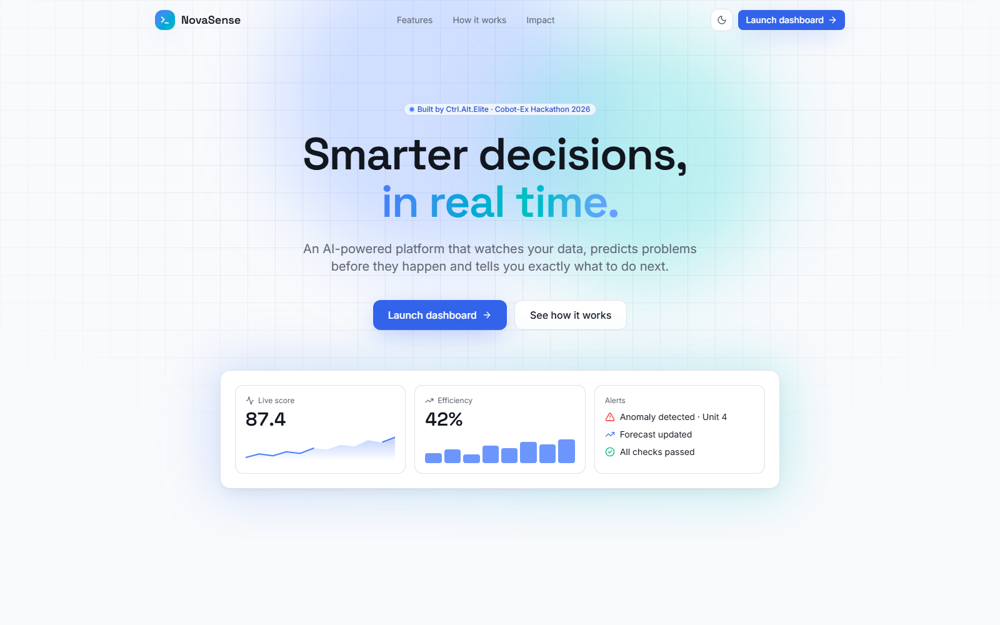
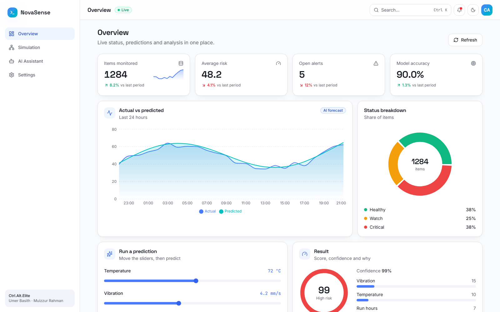

---
title: NovaSense
subtitle: Predicting machine failures before they happen
team: Ctrl.Alt.Elite
members: Umer Basith, Muizzur Rahman
event: Cobot-Ex Hackathon 2026 · Round 1
brand: #6D4AFF
---

# Executive summary

NovaSense is a working web platform that predicts which machines are about to fail, explains **why**, and tells the team what to do next. It combines a machine-learning model, a live dashboard and a plain-English AI assistant.

> In testing on 1,000 rows the model never saw, NovaSense reached **90% accuracy** and **0.96 ROC-AUC**, and scores a machine in under one second.

# Problem statement

Unplanned downtime is one of the largest hidden costs in manufacturing. Teams usually find out a machine is failing only after production stops.

- Breakdowns are found late, after damage is done.
- Root causes are guessed by experts, which is slow.
- Data exists (temperature, vibration, load) but nobody watches it continuously.

# Proposed solution

| Part | What it does | Built with |
|---|---|---|
| Risk model | Scores failure risk 0-100 and lists the top causes | scikit-learn (gradient boosting) |
| Dashboard | Live KPIs, forecast chart, status mix, records | React, Tailwind CSS, Recharts |
| AI assistant | Answers questions using live data | FastAPI + LLM with rule fallback |
| Data upload | Analyses any CSV in seconds | pandas |

# Architecture

{width=6.2}

1. Data arrives from sensors or a CSV upload.
2. The FastAPI backend validates every input and stores history in SQLite.
3. The model scores risk and explains the main factors.
4. The dashboard shows results and alerts in real time.

# Results and validation

{width=6.2}

| Metric | Value | How measured |
|---|---|---|
| Accuracy | 90.0% | 1,000 held-out rows |
| ROC-AUC | 0.96 | Same held-out rows |
| Response time | < 1 s | API call on a laptop |
| Automated tests | 6 / 6 passing | pytest |

> Honest note: the model was trained on a synthetic dataset designed around real sensor ranges. Using real plant data is the next step.

# Impact

- Fewer surprise breakdowns, because risk is visible hours earlier.
- Faster repairs, because the main cause is shown with every alert.
- Lower cost to start: runs on a normal laptop, no special hardware.

# Future scope

- Pilot on one real production line with live sensors.
- Edge device for factories with poor internet.
- Mobile alerts and multi-plant view.

# Conclusion

NovaSense turns raw machine data into clear, timely actions. It is working today, tested, and ready for a real pilot.
